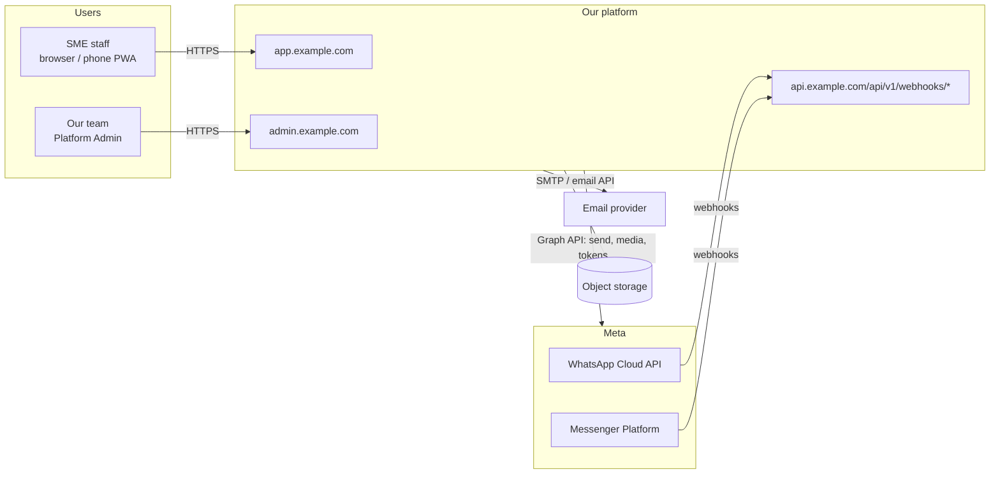
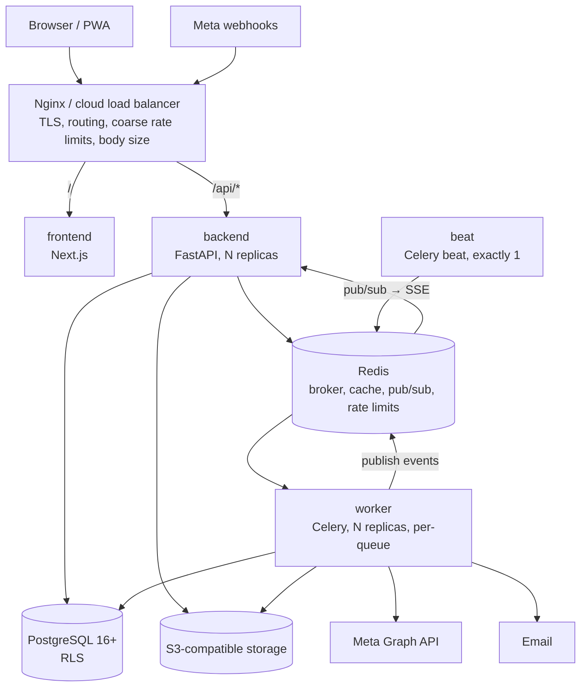
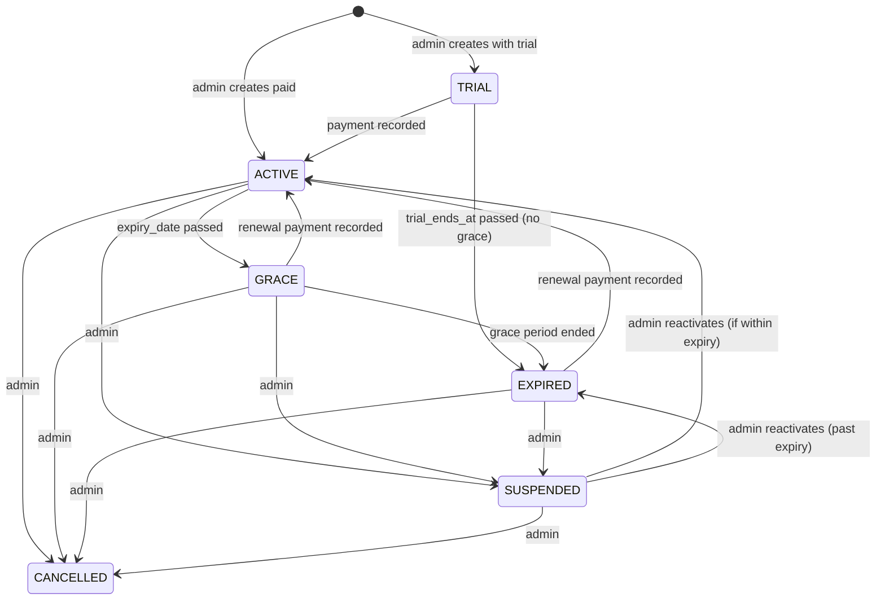
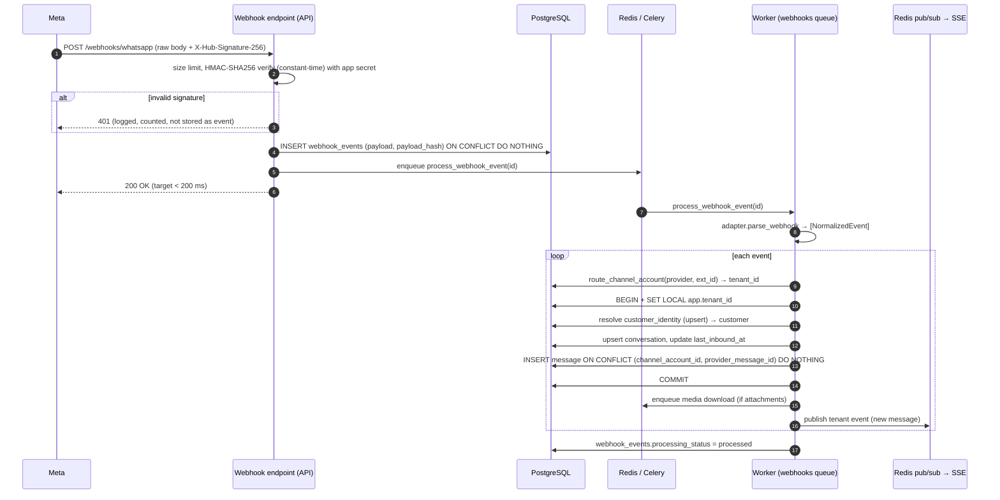
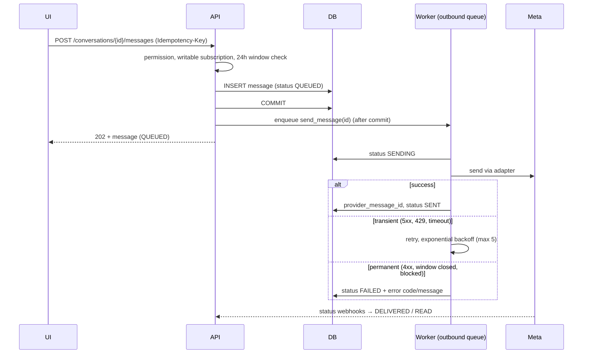
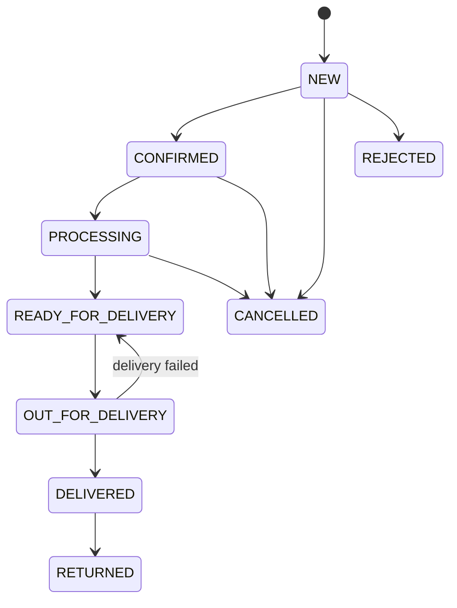
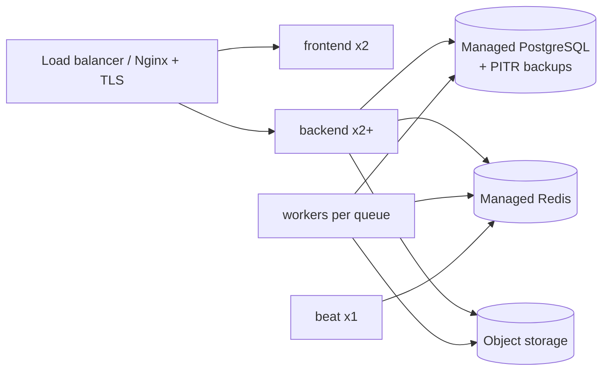

# Architecture

Multi-tenant social-commerce SaaS for SMEs (Nepal first).

> **Status:** MVP architecture, v0.1 (2026-10-27).
> **Source of truth for requirements:** `social-media-management.md` (the specification).
> **Database design and ERD:** [`DATABASE.md`](DATABASE.md).

---

## 1. What the system does

```text
WhatsApp / Messenger message
   ↓
Customer identified or created
   ↓
Conversation in the unified inbox (staff reply)
   ↓
Order created from the conversation (source channel recorded)
   ↓
Invoice (PDF)
   ↓
Delivery recorded manually   — delivered? when? by whom?
   ↓
Payment recorded manually    — paid? how much? which method? when?
   ↓
Customer 360 + dashboard
```

Each SME is a **tenant** with a paid **subscription** (package, price, status, expiry). Our team sets up tenants through the **Platform Admin Console**.

### MVP scope at a glance

| In MVP | Not in MVP |
|---|---|
| WhatsApp Cloud API, Facebook Messenger | TikTok, Instagram (adapter interface ready) |
| Unified inbox, real-time updates, replies in 24h window | WhatsApp template messages, automated follow-ups |
| Customers, identities, duplicate suggestions, merge/unmerge | AI (intent, product matching, suggested replies) |
| Products, variants, prices, stock quantity | Quotations, leads pipeline |
| Orders, invoices + PDF | Payment gateways, courier APIs, COD reconciliation |
| Manual delivery records, manual payment records | Self-service sign-up, online subscription billing |
| Subscriptions, plans, limits, expiry enforcement | Native mobile apps |
| Platform Admin Console | |
| RBAC, audit log, encrypted credentials, RLS | |

---

## 2. Architectural style

**Modular monolith.** One backend codebase and one database, split into clear domain modules with explicit boundaries. It runs as several processes (API, workers, scheduler) that scale independently.

Why not microservices: one small team, one database, strong consistency needs (order ↔ invoice ↔ payment), and no independent scaling problem yet. Module boundaries are kept clean so a module (e.g. ingestion or AI) can be extracted later if needed.

Rules that keep it modular:

- Provider-specific code lives only in `integrations/<provider>/`. Business services never import a provider SDK or know about Meta payload shapes.
- Modules talk through **service** functions, not each other's repositories or tables.
- API routers are thin: validate → authorize → call service → map to schema.
- All database access goes through repositories that require a tenant context (§6).

---

## 3. System context



---

## 4. Runtime components



| Service | Responsibility | Scaling |
|---|---|---|
| `nginx` | TLS, host/path routing, gzip, request size limits, coarse IP rate limits, SSE pass-through | 1+ (or cloud LB) |
| `frontend` | Next.js app: tenant app and platform admin UI | stateless, N |
| `backend` | REST API, webhook receivers, SSE stream, OpenAPI | stateless, N |
| `worker` | webhook processing, outbound sends, media download, PDF, email, recomputations | N, per queue |
| `beat` | scheduled jobs (subscription status, reminders, retries sweep, token checks, cleanup) | exactly 1 |
| `postgres` | system of record | managed in production |
| `redis` | Celery broker, cache, pub/sub, rate-limit counters | managed in production |
| object storage | media, product images, logos, invoice PDFs | S3 / R2 / Spaces / Azure Blob via S3 gateway / SeaweedFS |

Development adds `storage` (SeaweedFS, S3-compatible) and `mailpit` (email capture).

### Hosts

| Host | Serves |
|---|---|
| `app.<domain>` | tenant app (Next.js) and `/api/*` (FastAPI) — **same origin**, so cookies are first-party and CORS is not needed for the app |
| `admin.<domain>` | platform admin UI and `/api/*` — separate cookie jar from the tenant app |
| `api.<domain>` | webhooks only (`/api/v1/webhooks/*`) and health checks |

Domains are configuration, not code.

---

## 5. Repository layout

```text
/
├── backend/
│   ├── app/
│   │   ├── api/v1/
│   │   │   ├── auth/  tenants/  users/  customers/  conversations/  messages/
│   │   │   ├── channels/  products/  orders/  invoices/  deliveries/  payments/
│   │   │   ├── dashboard/  subscription/  notifications/  events/      # tenant API
│   │   │   ├── platform/      # platform admin API (tenants, plans, subscriptions)
│   │   │   ├── webhooks/      # whatsapp, messenger
│   │   │   └── audit/
│   │   ├── core/              # config, security, permissions, logging, database, exceptions, crypto
│   │   ├── models/            # SQLAlchemy models
│   │   ├── schemas/           # Pydantic v2 request/response models
│   │   ├── services/          # business logic per domain
│   │   ├── repositories/      # tenant-scoped data access
│   │   ├── integrations/
│   │   │   ├── base.py        # SocialChannelAdapter + normalized event types
│   │   │   ├── whatsapp/
│   │   │   ├── messenger/
│   │   │   └── storage/  email/
│   │   ├── workers/           # Celery app, tasks per queue, beat schedule
│   │   ├── middleware/        # request id, security headers, rate limit, tenant context
│   │   └── main.py
│   ├── alembic/
│   ├── tests/  (unit/ integration/ security/)
│   ├── pyproject.toml
│   └── Dockerfile
├── frontend/
│   ├── src/
│   │   ├── app/
│   │   │   ├── (auth)/        # login, change-password (forced first login), reset-password
│   │   │   ├── (tenant)/      # dashboard, inbox, customers, orders, ...
│   │   │   └── (platform)/    # platform admin console
│   │   ├── components/  features/  lib/  hooks/  services/  types/
│   │   └── proxy.ts           # route guard (named middleware.ts before Next.js 16)
│   ├── e2e/                   # Playwright
│   └── Dockerfile
├── infra/
│   ├── nginx/
│   ├── postgres/init/         # DB roles, extensions
├── docs/                      # ARCHITECTURE.md, DATABASE.md, SECURITY.md, ...
├── docker-compose.yml         # + docker-compose.dev.yml, docker-compose.prod.yml
├── .env.example
└── README.md
```

---

## 6. Multi-tenancy and isolation

Tenant isolation is enforced in **three independent layers**. A bug in one layer must not leak data.

### Layer 1 — request context

- The access token carries `sub` (user id) and `tid` (active tenant id).
- A FastAPI dependency loads the user's **membership** in `tid`, checks it is active, loads roles/permissions, and builds a `TenantContext(tenant_id, user_id, permissions, subscription_state)`.
- `tenant_id` is **never** taken from the URL, body or query string.

### Layer 2 — repositories

- Every tenant repository receives the `TenantContext` and adds `tenant_id = :tid` to every query and every insert.
- Resource lookups are `get(tenant_id, id)`; an id from another tenant returns **404**, not 403, so existence is not revealed.

### Layer 3 — PostgreSQL Row-Level Security

Every tenant-owned table has RLS **enabled and forced**:

```sql
ALTER TABLE orders ENABLE ROW LEVEL SECURITY;
ALTER TABLE orders FORCE ROW LEVEL SECURITY;

CREATE POLICY tenant_isolation ON orders
  USING      (tenant_id = current_setting('app.tenant_id', true)::uuid)
  WITH CHECK (tenant_id = current_setting('app.tenant_id', true)::uuid);
```

Each request/job transaction starts with:

```sql
SET LOCAL app.tenant_id = '<uuid>';
```

`SET LOCAL` is scoped to the transaction, so a pooled connection can never carry one tenant's context into another request. If the setting is missing, the policy matches **no rows**.

Composite foreign keys `(tenant_id, parent_id) → parent(tenant_id, id)` make it impossible to link a row to another tenant's parent (see `DATABASE.md` §3).

### Database roles

| Role | Used by | RLS | Notes |
|---|---|---|---|
| `app_owner` | Alembic migrations only | owner | not used at runtime |
| `app_runtime` | tenant API, workers doing tenant work | **enforced** | no `BYPASSRLS`; no `UPDATE/DELETE` on `audit_logs` |
| `app_platform` | platform admin API, system jobs (subscription status, cleanup) | bypass | every use is audit-logged; never reachable from tenant routes |

Login and token refresh run before a tenant is chosen, so they need the user's memberships across tenants. Instead of using `app_platform`, the auth path calls the `SECURITY DEFINER` function `auth_user_memberships(user_id)`, which returns only that user's active memberships (tenant id, business name, whether they are Owner).

Webhook routing needs one cross-tenant lookup ("which tenant owns WhatsApp phone number id X?"). This is a `SECURITY DEFINER` function `route_channel_account(provider, external_account_id)` that returns only `(tenant_id, channel_account_id)`. The ingestion worker stays on `app_runtime`.

### Mandatory tests

Automated tests create two tenants and prove that, for every tenant API resource, tenant A cannot list, read, update, delete, or reference tenant B's data — through the API (IDOR), through repositories, and directly against PostgreSQL with RLS.

---

## 7. Identity, authentication and authorization

### Two kinds of users

| | Tenant users (`users`) | Platform users (`platform_users`) |
|---|---|---|
| Who | SME owners and staff | our team |
| Belongs to | 1..n tenants via `tenant_memberships` | no tenant |
| Login | `app.<domain>` | `admin.<domain>`, separate cookie, MFA required |
| Roles | OWNER, ADMIN, MANAGER, SALES, DELIVERY, ACCOUNTANT, VIEWER | PLATFORM_SUPER_ADMIN, PLATFORM_ADMIN, PLATFORM_SUPPORT |

A tenant user can belong to more than one tenant (e.g. an accountant serving several SMEs) and switches active tenant explicitly; switching issues new tokens.

### Account creation (MVP)

Full user-facing flow: [`ONBOARDING_AND_CHANNEL_SETUP.md`](ONBOARDING_AND_CHANNEL_SETUP.md) §3.

1. Platform admin creates the tenant, subscription and the Owner user (login = email).
2. System generates a random **temporary password** (14 chars), stores only its Argon2id hash, sets `must_change_password = true` and `temp_password_expires_at = now + 7 days`, and shows it to the admin **once** (copy-for-WhatsApp message or email).
3. Owner logs in. While `must_change_password` is true, every endpoint except `change-password`, `me` and `logout` returns `403 password_change_required`.
4. After the change: all sessions are revoked, the temporary password is invalid, and an email verification link is sent (needed before password reset works).
5. Owner/Admin add staff the same way. Platform admin can **reset login** (new temporary password; old one invalid immediately). All steps audit-logged.

No public registration endpoint in the MVP.

### Sessions and tokens

- Passwords: **Argon2id** (`argon2-cffi`), parameters in config.
- **Access token:** JWT, 15 minutes, `HttpOnly; Secure; SameSite=Lax` cookie. Claims: `sub`, `tid`, `typ` (`user`/`platform`), `sid`, `exp`, `jti`. Signed with a key from config (key id in header for rotation).
- **Refresh token:** opaque random 256-bit value, cookie scoped to `/api/v1/auth/refresh`, stored **hashed** in `refresh_tokens`. Rotated on every use. Reuse of an already-rotated token revokes the whole token family (stolen-token detection).
- **CSRF:** double-submit token (`csrf_token` cookie readable by JS + `X-CSRF-Token` header) required on all state-changing requests that use cookie auth.
- Login lockout and rate limiting per account and per IP; failed logins are audit-logged.
- MFA (TOTP) is **required for platform users** in the MVP and available as an option for tenant users (schema is ready).
- No tokens in `localStorage` or `sessionStorage`.

### Authorization (RBAC)

Permissions are checked in the backend with a dependency:

```python
@router.post("/orders")
async def create_order(..., ctx: TenantContext = Depends(require("order.write"), writable_subscription)):
    ...
```

MVP uses the system roles below (custom roles later; schema supports them).

| Permission | OWNER | ADMIN | MANAGER | SALES | DELIVERY | ACCOUNTANT | VIEWER |
|---|:-:|:-:|:-:|:-:|:-:|:-:|:-:|
| conversation.read | ✓ | ✓ | ✓ | ✓ | | | ✓ |
| conversation.write (reply, assign) | ✓ | ✓ | ✓ | ✓ | | | |
| customer.read | ✓ | ✓ | ✓ | ✓ | ✓ | ✓ | ✓ |
| customer.write | ✓ | ✓ | ✓ | ✓ | | | |
| customer.merge | ✓ | ✓ | ✓ | | | | |
| product.read | ✓ | ✓ | ✓ | ✓ | ✓ | ✓ | ✓ |
| product.write (incl. stock) | ✓ | ✓ | ✓ | | | | |
| order.read | ✓ | ✓ | ✓ | ✓ | ✓ | ✓ | ✓ |
| order.write | ✓ | ✓ | ✓ | ✓ | | | |
| invoice.read | ✓ | ✓ | ✓ | ✓ | | ✓ | ✓ |
| invoice.write (issue, cancel) | ✓ | ✓ | ✓ | | | ✓ | |
| delivery.read | ✓ | ✓ | ✓ | ✓ | ✓ | | ✓ |
| delivery.write | ✓ | ✓ | ✓ | | ✓ | | |
| payment.read | ✓ | ✓ | ✓ | | | ✓ | ✓ |
| payment.write (record, void) | ✓ | ✓ | ✓ | | ✓¹ | ✓ | |
| report.read (dashboard) | ✓ | ✓ | ✓ | | | ✓ | ✓ |
| channel.manage | ✓ | ✓ | | | | | |
| user.manage | ✓ | ✓ | | | | | |
| settings.manage | ✓ | ✓ | | | | | |
| subscription.read | ✓ | ✓ | | | | ✓ | |
| audit.read | ✓ | ✓ | | | | | |

¹ DELIVERY can record COD collected on deliveries assigned to them, not void payments.

Only an OWNER can grant or remove the OWNER role. A tenant must always have at least one active OWNER.

---

## 8. SaaS subscriptions and entitlements

Full rules are in the specification §42. Architecturally:

### Subscription state machine



- Time-based transitions run in a daily beat job (`subscriptions.recompute_statuses`, runs at 00:15 Asia/Kathmandu) using `app_platform`. Status is also recomputed on read, so access is correct even if the job is late.
- Every transition writes `subscription_history` and `audit_logs`, and invalidates the cached state.

### Enforcement

`SubscriptionService.state(tenant_id)` is cached in Redis (60s TTL, invalidated on change) and attached to `TenantContext`.

| Dependency | Allows when |
|---|---|
| `active_subscription` (all tenant routes) | TRIAL, ACTIVE, GRACE, EXPIRED |
| `writable_subscription` (all state-changing tenant routes) | TRIAL, ACTIVE, GRACE |
| login for SUSPENDED / CANCELLED | Owner only, lands on "contact us" page |

**Inbound webhooks are always processed** regardless of subscription state, so no customer messages are lost. Outbound sends are blocked when not writable.

### Entitlements

```python
await entitlements.require(ctx, "max_users", adding=1)       # raises PlanLimitExceeded
await entitlements.enabled(ctx, "feature.invoice_pdf")       # bool
```

- Limits come from `plan_features` of the tenant's current plan. `NULL` = unlimited.
- Count-based limits (users, channels, products) are computed live with a `SELECT count(*)` inside the same transaction as the insert (with a tenant-level advisory lock to avoid races).
- Period limits (monthly orders/messages) use `usage_records`, incremented in the same transaction as the action.
- No plan numbers anywhere else in the code.

### Reminders

Beat job `subscriptions.send_expiry_reminders` daily: emails the Owner at 15/7/3/1 days before expiry and on entering GRACE/EXPIRED; idempotent per (subscription, reminder_kind, expiry_date).

---

## 9. Channel integration architecture

### Adapter interface

```python
class SocialChannelAdapter(ABC):
    provider: ClassVar[Provider]

    async def verify_subscription_challenge(self, params: Mapping[str, str]) -> str | None: ...
    async def validate_webhook(self, headers: Mapping[str, str], raw_body: bytes) -> None: ...  # raises
    def parse_webhook(self, payload: dict) -> list[NormalizedEvent]: ...                       # pure, no I/O
    async def send_message(self, account: ChannelAccountRef, to: str, msg: OutboundContent) -> SendResult: ...
    async def fetch_media(self, account: ChannelAccountRef, media_ref: str) -> MediaStream: ...
    async def get_customer_profile(self, account: ChannelAccountRef, provider_user_id: str) -> ProfileInfo | None: ...
    async def complete_connection(self, tenant_id: UUID, oauth_result: dict) -> ConnectionResult: ...
    async def refresh_token(self, credential: DecryptedCredential) -> DecryptedCredential | None: ...
    async def disconnect(self, account: ChannelAccountRef) -> None: ...
```

`NormalizedEvent` is a provider-neutral union:

```text
InboundMessage   (channel_account_ext_id, provider_user_id, provider_message_id, timestamp,
                  type, text, media_refs, reply_to, profile_name, phone?)
MessageStatus    (provider_message_id, status: sent|delivered|read|failed, timestamp, error?)
AccountEvent     (e.g. phone number quality change, token revoked, page unsubscribed)
Unsupported      (kept for audit, not processed)
```

Adding Instagram/TikTok later = new adapter + registry entry + setup screen. Nothing in customers, orders, invoices or payments changes.

### WhatsApp (Cloud API)

- **Connection:** Meta **Embedded Signup** (requires our Meta app to be a Tech Provider with business verification and app review). Flow returns an auth code → backend exchanges it for a business integration token → stores WABA id, phone number id, display number → subscribes our app to the WABA's webhooks → registers the number if needed.
- **Coexistence:** support numbers that also stay on the WhatsApp Business app (Meta coexistence onboarding); echoes of messages sent from the phone app are stored as outbound messages with `sender_type = external_app`.
- **Customer service window:** free-form replies are allowed only within 24h of the customer's last inbound message (`conversations.last_inbound_at`). Outside the window the MVP UI disables the composer and shows "window closed — template messages coming soon". Template messages are post-MVP.
- Identity: `wa_id` (phone-derived today). The model does not assume a phone number is always present, because Meta is introducing usernames and business-scoped user ids.

### Messenger

- **Connection:** Facebook Login for Business → user selects Page(s) → backend exchanges for long-lived Page access token → subscribes the Page to `messages`, `message_deliveries`, `message_reads`, `message_echoes`, `messaging_postbacks`.
- Identity: Page-scoped id (PSID) — unique **per Page**, carries no phone number. Cross-channel matching relies on the customer sharing their phone/email in chat (§11).
- Standard 24h messaging window; message tags (e.g. `HUMAN_AGENT`) are post-MVP.

### Connection wizards

The step-by-step SME experience for both channels (requirements, screens, backend steps, errors, health, disconnect) is specified in [`ONBOARDING_AND_CHANNEL_SETUP.md`](ONBOARDING_AND_CHANNEL_SETUP.md). Each wizard attempt is a server-side **setup session** (`channel_setup_sessions`) holding the OAuth `state`, completed steps and last error, so a failed attempt can be resumed and support can see where it failed.

### Meta app setup

One Meta app serves both products. Webhook callback URLs are separate per product:

```text
https://api.<domain>/api/v1/webhooks/whatsapp
https://api.<domain>/api/v1/webhooks/messenger
```

Required permissions/review items, Tech Provider steps and test numbers go in `WHATSAPP_SETUP.md` and `MESSENGER_SETUP.md`.

### Credentials

- Stored only in `channel_credentials`, encrypted (§13). Decrypted only inside workers/adapter calls, never returned by any API, never logged.
- The UI shows token **status** (valid / expiring / invalid / revoked) and last check time.
- Beat job `channels.check_tokens` (daily) validates tokens via the debug-token endpoint and marks connections unhealthy; Owners/Admins are notified.

---

## 10. Inbound message pipeline



Design rules:

- **Fast acknowledgement.** The endpoint only verifies, stores and enqueues. No parsing of business logic, no outbound calls.
- **Store first.** The raw event is committed before the 200, so if a worker is down nothing is lost; a beat sweeper re-enqueues `received` events older than 2 minutes.
- **Idempotency at two levels.** Exact redeliveries are dropped by `UNIQUE (provider, payload_hash)`. Meta batches several messages per POST and has no per-delivery id, so the real dedup key is per item: `UNIQUE (channel_account_id, provider_message_id)` on `messages` and `UNIQUE (message_id, event_type)` on `message_events`.
- **Ordering.** Messages are ordered by provider timestamp, not arrival. Status updates are monotonic (`read` never goes back to `delivered`). A status that arrives before its message is retried with backoff.
- **Concurrency.** Two events for the same new customer can be processed in parallel; identity creation uses `INSERT … ON CONFLICT DO NOTHING` + re-select inside the transaction.
- **Failures.** Transient errors retry with exponential backoff + jitter (max 8 attempts). After that the event becomes `dead` (dead-letter) and appears in the platform admin "failed events" view with a replay button. Each attempt is recorded in `webhook_event_attempts`.
- **Unknown accounts.** Events for an unconnected/disconnected account are marked `ignored` and kept for the retention period.
- Raw payloads are retained 30 days, then the payload is purged (row kept).

### Media

Inbound media is fetched by a `media` worker: get the media URL with the account token → download with a size cap and timeout → verify MIME by content (not by header) → store in S3 under `tenants/{tenant_id}/media/{yyyy}/{mm}/{uuid}` → checksum → `scan_status = pending` (pluggable scanner; ClamAV optional in MVP). The UI serves files through short-lived signed URLs from the API.

---

## 11. Customer identity resolution

```text
Inbound event (provider, channel_account, provider_user_id, profile_name, phone?)
   │
   ├─ 1. Existing customer_identity for (channel_account, provider_user_id)?  → that customer (certain)
   │
   ├─ 2. Phone available (WhatsApp)? normalize to E.164 (default region NP)
   │      exact match on an active customer's phone in this tenant?           → link identity (high)
   │
   └─ 3. Otherwise create a new customer + identity
          then enqueue duplicate scan (async)
```

Duplicate scan (async, never auto-merges):

| Signal | Score |
|---|---|
| Same verified email | 0.9 |
| Same normalized phone found in another customer's identities, addresses or notes | 0.85 |
| Phone/email the customer **typed in a message** matches another customer | 0.8 |
| Name similarity (trigram) **and** same city/area | 0.4 |
| Name similarity alone | not a signal |

Candidates with score ≥ 0.6 are stored in `customer_duplicate_candidates` and shown as "Possible duplicate" to users with `customer.merge`.

**Merge** moves identities, conversations, orders, invoices, deliveries, payments, addresses, notes and tags from the source to the target customer in one transaction, sets the source to `status = merged, merged_into = target`, and stores the full list of moved row ids in `customer_merges.snapshot`. **Unmerge** uses that snapshot to move the rows back (rows created after the merge stay on the target). Both are audit-logged.

Phone extraction from message text (Nepali mobile formats, `+977`, `98XXXXXXXX`) is a deterministic regex in the MVP; it creates duplicate suggestions, not links.

---

## 12. Outbound messages



- Enqueue happens **after commit**; a beat sweeper re-enqueues `QUEUED` messages older than 1 minute, so a crash between commit and enqueue cannot lose a message.
- Per-channel-account rate limiting in the worker (token bucket in Redis) respects Meta throughput limits.
- Status changes are pushed to the UI over SSE.

---

## 13. Secrets and encryption

| Data | Protection |
|---|---|
| Channel access tokens | AES-256-GCM, per-record random nonce, AAD = `tenant_id \|\| credential_id`, `key_version` stored per row |
| TOTP secrets | same as above |
| Passwords | Argon2id hash |
| Refresh / reset / email-verification tokens | SHA-256 hash of a 256-bit random token |
| Data in transit | TLS everywhere; Postgres/Redis TLS in production |
| Data at rest | provider disk/volume encryption for Postgres, Redis and S3 |

`core/crypto.py` exposes `encrypt(plaintext, aad) -> EncryptedBlob` / `decrypt(blob, aad)` behind a `KeyProvider` interface:

- MVP: `EnvKeyProvider` — keys from `ENCRYPTION_KEYS` (`v1:<base64>,v2:<base64>`), newest used for writes.
- Later: `KmsKeyProvider` (AWS KMS / Azure Key Vault / GCP KMS) wrapping per-record data keys (envelope encryption). No schema change needed.

Key rotation: add a new version → background job re-encrypts rows → remove the old key.

Logging uses a redaction filter for known secret fields (`access_token`, `authorization`, `password`, `token`, `secret`, `code`) and never logs raw webhook bodies at INFO.

---

## 14. Real-time updates

- **Server-Sent Events** at `GET /api/v1/events/stream` (cookie auth). One-way server→browser is all the inbox needs; sends go through REST. SSE works through Nginx with `proxy_buffering off` and reconnects automatically (`Last-Event-ID`).
- Workers publish small events to Redis channel `tenant:{tenant_id}`: `message.created`, `message.status`, `conversation.updated`, `order.updated`, `notification.created`, `subscription.changed`.
- Each API instance subscribes, filters events by the connected user's permissions, and forwards **ids + minimal fields**. The UI then refetches through TanStack Query, so authorization is always applied by the normal REST endpoints.
- If SSE is unavailable, the UI falls back to polling every 15s.

---

## 15. Sales, invoicing, delivery and payment records

### Orders



- Allowed transitions live in one table in `services/orders/state.py`; any other transition is rejected.
- Every change writes `order_status_history` + `audit_logs`.
- Stock: `CONFIRMED` writes `inventory_transactions` (−qty); `CANCELLED`/`RETURNED` writes (+qty). Negative stock is allowed but flagged (configurable).
- Delivery status drives order status: marking the delivery `OUT_FOR_DELIVERY` / `DELIVERED` moves the order accordingly.
- `source_channel`, `source_conversation_id`, `lead_source` are set at creation and are the basis of channel revenue reporting.

### Money

- `NUMERIC(14,2)` everywhere, Python `Decimal`, rounding `ROUND_HALF_UP` at line level. No floats.
- One currency per tenant (default NPR). Amounts carry `currency` for future multi-currency.
- Totals are always computed by the backend; client-sent totals are ignored.
- Tax: per-product tax rate (default VAT 13% when the tenant is VAT-registered, 0% otherwise). Prices can be configured as tax-inclusive or tax-exclusive per tenant.

### Invoices

- MVP: one invoice per order.
- `DRAFT` → `ISSUED` → (`CANCELLED`). Once issued, the invoice and its items are **immutable**; corrections are cancel + reissue (credit notes post-MVP).
- Seller and buyer details are **snapshotted** on the invoice (business name, PAN/VAT, address), so later edits don't change past invoices.
- PDF generated by a `pdf` worker (WeasyPrint, HTML template, Noto Sans + Noto Sans Devanagari fonts), stored in S3, served by signed URL.
- Nepal IRD invoice format compliance (fields, wording, numbering per fiscal year) must be reviewed with an accountant before launch.

### Human-readable numbers

`ORD-…`, `INV-…`, `PAY-…`, `DEL-…` come from `document_sequences (tenant_id, doc_type, period_key)` using `UPDATE … SET next_value = next_value + 1 RETURNING` in the same transaction — gap-free per tenant and period, safe under concurrency.

Period is a tenant setting:

- `ad_year` → `ORD-2026-000001`
- `np_fiscal_year` → `ORD-2082-83-000001` (Nepali fiscal year starting 1 Shrawan; computed with a Bikram Sambat calendar library)

Subscription receipts (`SUB-…`) use the same mechanism at platform level.

### Deliveries (manual records)

- Delivery method: own staff / courier (free-text name) / customer pickup; optional tracking reference; expected COD amount.
- Several attempts per order are allowed; only one may be open at a time.
- Every status change → `delivery_status_history` (who, when, note).

### Payments (manual records)

- Each payment: amount, method, reference, `paid_at`, `recorded_by`. `type = payment | refund`.
- Rows are never edited. Corrections = **void** (with reason) + new record.
- Order/invoice `amount_paid`, `amount_due` and `payment_status` (UNPAID / PARTIAL / PAID / REFUNDED) are recomputed in the same transaction as any payment insert/void. `OVERDUE` is derived from `due_date` at query time.
- Payments can be recorded before the invoice exists (advance payment) — they belong to the order, and optionally to the invoice.

---

## 16. API design

- REST, JSON, `/api/v1/...`, OpenAPI generated by FastAPI (served only in non-production or behind auth).
- Ids are UUIDs (UUIDv7, generated in the application).
- **Pagination:** cursor-based (`?limit=50&cursor=…`, max 100) for lists that grow (messages, conversations, orders); offset only for small admin lists.
- **Filtering/sorting:** explicit allowlisted query params per endpoint (`?status=…&channel=…&sort=-created_at`). No generic query language.
- **Errors:** RFC 9457 problem details: `{type, title, status, detail, code, request_id}`. No stack traces or internal ids.
- **Idempotency:** `Idempotency-Key` header required on order creation, invoice issue, payment record/void, outbound message, subscription payment. Stored in `idempotency_keys` for 24h with the request hash and response; replay returns the stored response; same key + different body → `422`.
- **Concurrency:** optimistic locking via `version` column on orders, invoices, deliveries, customers; clients send `If-Match`; mismatch → `409`.
- Max body size: 1 MB for JSON, 10 MB for uploads (configurable), webhooks 1 MB.

Route groups:

```text
/api/v1/auth/*            login, refresh, logout, change-password, password reset, switch-tenant, mfa
/api/v1/<tenant resources> customers, conversations, messages, channels, products, orders,
                          invoices, deliveries, payments, dashboard, notifications,
                          subscription (read-only), users, settings, audit
/api/v1/events/stream     SSE
/api/v1/platform/*        tenants, plans, prices, features, subscriptions,
                          subscription-payments, failed-events, metrics (platform users only)
/api/v1/webhooks/*        whatsapp, messenger (GET verify + POST events)
/health, /health/live, /health/ready
```

---

## 17. Background jobs

| Queue | Tasks | Notes |
|---|---|---|
| `webhooks` | process webhook events | highest priority, own workers |
| `outbound` | send messages | per-account rate limit |
| `media` | download/store/scan media | network heavy |
| `default` | duplicate scan, recomputations, notifications, emails | |
| `pdf` | invoice PDFs, receipts | CPU heavy, low concurrency |

Beat schedule (Asia/Kathmandu):

| Job | Schedule |
|---|---|
| Recompute subscription statuses | daily 00:15 |
| Expiry reminders | daily 09:00 |
| Re-enqueue stuck webhook events / queued messages | every minute |
| Channel token health check | daily 03:00 |
| Purge raw webhook payloads > 30 days, expired idempotency keys, expired tokens | daily 02:00 |
| Usage counters rollover | monthly |

Implementation notes:

- Celery with Redis broker, `acks_late = True`, `task_reject_on_worker_lost = True`, every task idempotent.
- Tasks call the same async service layer as the API. Each worker process creates one event loop and one async SQLAlchemy engine at `worker_process_init` and runs tasks on it — engines are never shared across loops.
- Every task carries `tenant_id`, `request_id`/`correlation_id` and sets the tenant DB context itself.

---

## 18. Frontend architecture

- Next.js (latest stable at scaffold time), App Router, TypeScript strict, Tailwind, shadcn/ui, TanStack Query, React Hook Form + Zod.
- **Client-rendered app shell.** Data is fetched from the browser directly to `/api/*` on the same origin, with cookies. The Next.js server does not proxy API calls or hold tokens — there is no backend-for-frontend layer to secure.
- `proxy.ts` only redirects users without a session cookie to the login page; real authorization is always the API's job.
- Permissions from `/api/v1/auth/me` hide UI the user can't use (UX only).
- Shared Zod schemas mirror the OpenAPI schema; TypeScript API types are generated from OpenAPI (`openapi-typescript`) in CI so frontend and backend can't drift.
- **Mobile first:** inbox, order creation, delivery and payment recording are designed for phone screens first. Installable **PWA** (manifest + service worker for the app shell; no offline data in MVP).
- Times stored UTC, displayed in the tenant timezone (default Asia/Kathmandu); optional Bikram Sambat date display.
- Languages: English UI in MVP; strings go through an i18n layer so Nepali can be added.

### Main screens (MVP)

Tenant app: Dashboard · Inbox (All / WhatsApp / Messenger + filters) · Customers (list, 360, duplicates) · Orders · Invoices · Deliveries · Payments · Products · Channels · Settings (business, users, roles, subscription, numbering, tax).

Platform admin: Tenants · Subscriptions (expiring / grace / expired) · Subscription payments · Plans & prices · Failed webhook events · Platform metrics · Audit.

---

## 19. Audit logging

- `audit_logs` is append-only: `app_runtime` has `INSERT` and `SELECT` only; no `UPDATE`/`DELETE` grants.
- Written in the **same transaction** as the action, so an action cannot succeed without its audit record.
- Inserted without `RETURNING`: PostgreSQL applies SELECT policies to returned rows, and pre-tenant rows (e.g. failed logins, `tenant_id NULL`) are deliberately not readable by tenants.
- Captures: actor (user / platform user / system), tenant, action code, resource type + id, before/after (changed fields only, secrets removed), IP, user agent, request id, timestamp.
- Actions: everything listed in spec §29 plus subscription and plan changes, subscription payments, tenant suspend/reactivate, platform access to a tenant, payment void, invoice cancel, customer merge/unmerge.
- Tenants see their own audit log; platform users see all.

---

## 20. Observability

- **Logs:** structured JSON to stdout (`structlog`): `timestamp, level, msg, request_id, correlation_id, tenant_id, user_id, route, status, duration_ms`. Secret redaction filter. No customer message bodies in logs.
- **Request id:** accepted from `X-Request-ID` (validated) or generated; returned in responses and error bodies; propagated into Celery tasks as `correlation_id`.
- **Errors:** Sentry SDK (backend, worker, frontend), with PII scrubbing; enabled when `SENTRY_DSN` is set.
- **Metrics:** Prometheus endpoint (internal only): HTTP latency/status, webhook receive/process counts and lag, queue depth, task failures, outbound send success/failure per provider, active SSE connections.
- **Tracing:** OpenTelemetry instrumentation for FastAPI, SQLAlchemy, httpx, Celery; exporter configured by env (off by default).
- **Health:**
  - `/health/live` — process is up (no dependencies).
  - `/health/ready` — DB and Redis reachable; returns only `ok`/`fail` per dependency, no versions or hostnames.
  - `/health` — alias of live.

---

## 21. Security controls summary

Detailed in `SECURITY.md` (to be written). Architectural controls:

| Area | Control |
|---|---|
| Tenant isolation | context + repositories + RLS + composite FKs + tests |
| AuthN | Argon2id, short JWT, rotating refresh tokens with reuse detection, lockout, MFA for platform |
| AuthZ | backend permission dependencies, 404 on foreign ids |
| CSRF | SameSite cookies + double-submit token |
| CORS | allowlist; app runs same-origin so CORS is closed by default |
| Rate limiting | Nginx per IP + Redis per user/tenant/endpoint; strict on auth and webhooks |
| Input | Pydantic strict models, max sizes, allowlisted filters, ORM parameterized queries |
| Webhooks | HMAC-SHA256 signature, raw-body verification, idempotency, size limits |
| SSRF | only allowlisted Meta hosts for outbound calls; user-supplied URLs are never fetched in MVP |
| Files | MIME sniffing, size limits, random object keys, private bucket, signed URLs, scanner hook |
| Headers | HSTS, CSP, X-Content-Type-Options, Referrer-Policy, frame-ancestors none |
| Secrets | env/secret manager only, encrypted credentials, redacted logs, `.env` never committed |
| Privacy | data minimization, retention jobs, customer/tenant export and deletion workflows (spec §28) |

---

## 22. Deployment

### Development

`docker compose -f docker-compose.yml -f docker-compose.dev.yml up` starts: frontend (hot reload), backend (reload), worker, beat, postgres, redis, storage (SeaweedFS), mailpit, nginx. Migrations and seed data (plans, roles, permissions, a platform super admin from env) run via a one-off `migrate` service.

Meta webhooks in development use a tunnel (e.g. Cloudflare Tunnel / ngrok) to `api.<dev-domain>`.

### Production (cloud-neutral)



- Same images for every environment; configuration only through environment variables / secret manager.
- Works on a single VPS with Docker Compose (`docker-compose.prod.yml`) for the first tenants, and on AWS / Azure / GCP / DigitalOcean with managed Postgres, Redis and S3-compatible storage. No provider-specific SDKs outside `integrations/storage`.
- Migrations run as a separate release step before new API/worker containers start; migrations must be backward compatible with the previous app version (expand → migrate → contract).
- Backups: managed PITR or `pgBackRest` with WAL archiving; daily restore test in staging. Object storage versioning on. Detailed in `DEPLOYMENT.md` / backup docs.

---

## 23. Scale assumptions

Target: 1,000+ tenants, 100k+ customers, millions of messages.

- All hot queries are tenant-scoped with `(tenant_id, …)` composite indexes.
- `messages` and `webhook_events` are the largest tables; both are designed so they can be converted to monthly range partitions (by `created_at`) without changing application code once they exceed ~50M rows. Not partitioned in the MVP.
- Dashboard aggregates are computed by SQL over indexed columns in the MVP; if slow, add per-tenant daily rollup tables refreshed by a worker.
- API and workers are stateless and scale horizontally; beat is a single instance.

---

## 24. Key decisions

| # | Decision | Alternatives considered | Reason |
|---|---|---|---|
| 1 | Modular monolith | microservices | team size, transactional consistency |
| 2 | Shared database, `tenant_id` + RLS | schema/db per tenant | 1,000+ tenants, simple ops, RLS gives DB-level safety |
| 3 | UUIDv7 generated in app | UUIDv4, DB `uuidv7()` | time-ordered for index locality; works on PostgreSQL 16 |
| 4 | Celery + Redis | arq, Dramatiq, RQ | spec preference, mature retries and beat; async handled per worker loop |
| 5 | SSE for real-time | WebSockets | one-way is enough, simpler through proxies |
| 6 | Same-origin cookies, no BFF | Next.js API proxy, bearer tokens in JS | smallest attack surface, no tokens in JS |
| 7 | Separate `platform_users` | flag on `users` | hard separation of our staff from tenants, separate login and MFA |
| 8 | Status as `text` + `CHECK` | PostgreSQL enums | easier migrations |
| 9 | Manual payments/deliveries as append-only records + void | editable rows | auditability, correct balances |
| 10 | One invoice per order (MVP) | many | matches SME practice; schema allows relaxing later |
| 11 | Embedded Signup as Meta Tech Provider | BSP partner | no per-message BSP markup; requires Meta verification early |

---

## 25. Open items

- Meta Tech Provider + business verification + app review — **start immediately**; it gates WhatsApp go-live.
- Accountant review of invoice layout and numbering against IRD requirements.
- Pricing of packages and default limits (`plan_features` seed data).
- Email provider choice (any SMTP/API provider; abstraction in place).
- Domain names and hosting for the first production environment.
- Decision on WhatsApp template messages (needed for follow-ups outside the 24h window) — first post-MVP item after Instagram.
