# Database Design and ERD

PostgreSQL 16+ schema for the MVP. Read with [`ARCHITECTURE.md`](ARCHITECTURE.md).

> **Status:** MVP schema, v0.1 (2026-10-27). Alembic migrations are generated from this design.

---

## 1. Conventions

| Topic | Rule |
|---|---|
| Primary keys | `id uuid PRIMARY KEY`, **UUIDv7 generated by the application**. Never sequential integers for API-visible rows. |
| Tenant column | every tenant-owned table has `tenant_id uuid NOT NULL` |
| Tenant FKs | tenant-owned parents expose `UNIQUE (tenant_id, id)`; children reference `(tenant_id, parent_id)` (§3) |
| Timestamps | `timestamptz`, stored UTC. All tables have `created_at`; mutable tables have `updated_at` (set by app + trigger) |
| Soft delete | `deleted_at timestamptz` only where listed (customers, products, users). Unique indexes are partial `WHERE deleted_at IS NULL` |
| Status / type columns | `text` + `CHECK (col IN (...))`, not PostgreSQL enums |
| Money | `numeric(14,2)` + `currency char(3)`; never float |
| Quantities | `numeric(12,3)` (allows kg/metres); UI shows integers for unit items |
| Optimistic locking | `version integer NOT NULL DEFAULT 1` on orders, invoices, deliveries, customers, products |
| Provider ids | stored in `provider_*` / `external_*` columns, never used as PKs |
| JSON | `jsonb` only for snapshots, provider extras and settings — never for data we filter or join on |
| Naming | `snake_case`, plural tables, `<table>_<cols>_key` for unique, `ix_<table>_<cols>` for indexes |
| Extensions | `citext` (emails), `pg_trgm` (name search / duplicate detection) |

Legend in diagrams: `PK` primary key, `FK` foreign key, `UK` part of a unique key. Every diagram omits `created_at` / `updated_at` / `version` unless they matter.

---

## 2. Domain overview

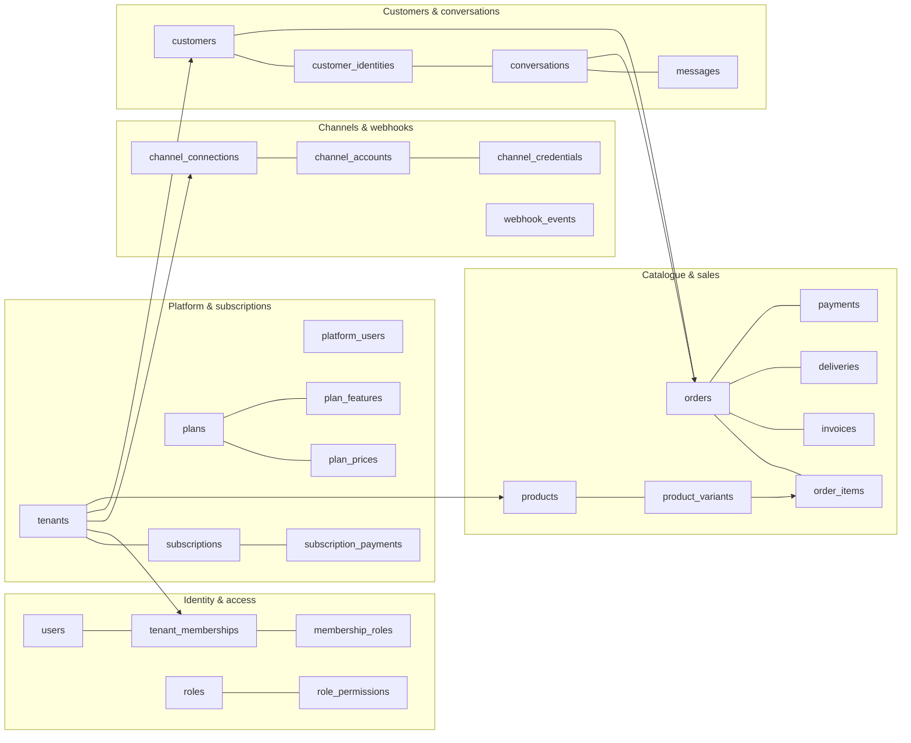

### Table inventory

| Domain | MVP tables | Tenant-owned (RLS) |
|---|---|---|
| Platform | `platform_users`, `plans`, `plan_prices`, `plan_features`, `tenants`, `tenant_settings`, `subscriptions`, `subscription_history`, `subscription_payments`, `usage_records` | `tenant_settings`, `subscriptions`¹, `subscription_history`¹, `subscription_payments`¹, `usage_records` |
| Identity & access | `users`, `tenant_onboarding`, `tenant_memberships`, `roles`, `permissions`, `role_permissions`, `membership_roles`, `auth_tokens`, `refresh_tokens` | `tenant_onboarding`, `tenant_memberships`, `membership_roles` |
| Audit & system | `audit_logs`, `idempotency_keys`, `document_sequences`, `notifications`, `stored_objects` | all (audit: nullable tenant²) |
| Channels | `channel_connections`, `channel_accounts`, `channel_credentials`, `channel_setup_sessions`, `webhook_events`, `webhook_event_attempts` | first four |
| Customers | `customers`, `customer_identities`, `customer_addresses`, `customer_tags`, `customer_tag_links`, `customer_notes`, `customer_duplicate_candidates`, `customer_merges` | all |
| Conversations | `conversations`, `messages`, `message_attachments`, `message_events` | all |
| Catalogue | `product_categories`, `tax_rates`, `products`, `product_variants`, `product_prices`, `product_images`, `inventory`, `inventory_transactions` | all |
| Sales | `orders`, `order_items`, `order_status_history`, `invoices`, `invoice_items` | all |
| Delivery | `deliveries`, `delivery_status_history` | all |
| Payment | `payments` | all |

¹ Tenant users can **read** their own subscription rows through RLS; only `app_platform` writes them.
² Platform-level audit rows have `tenant_id NULL`; RLS policy for `app_runtime` shows only rows of the current tenant.

Deferred to post-MVP (spec names kept for continuity): `leads`, `quotations`, `quotation_items`, `delivery_items` (partial shipments), `payment_transactions` (gateway attempts), `payment_status_history` (replaced by immutable payment rows + void), `conversation_participants` (group chats), `automation_rules`, `automation_events`, `scheduled_followups`, `message_templates`, `ai_requests`, `user_invitations` (email invite links — MVP uses admin-issued temporary passwords instead), `subscription_features` (= `plan_features`).

---

## 3. Tenant isolation in the schema

```sql
-- every tenant-owned parent
ALTER TABLE customers ADD CONSTRAINT customers_tenant_id_id_key UNIQUE (tenant_id, id);

-- every child references the parent *together with* tenant_id
ALTER TABLE orders
  ADD CONSTRAINT orders_customer_fk
  FOREIGN KEY (tenant_id, customer_id) REFERENCES customers (tenant_id, id);
```

This makes "order of tenant A pointing at customer of tenant B" impossible at the database level, independent of RLS.

RLS template applied by a migration helper to every tenant-owned table:

```sql
ALTER TABLE <t> ENABLE ROW LEVEL SECURITY;
ALTER TABLE <t> FORCE ROW LEVEL SECURITY;
CREATE POLICY tenant_isolation ON <t> FOR ALL TO app_runtime
  USING      (tenant_id = current_setting('app.tenant_id', true)::uuid)
  WITH CHECK (tenant_id = current_setting('app.tenant_id', true)::uuid);
```

Read-only exceptions for `app_runtime` (`subscriptions`, `subscription_history`, `subscription_payments`): `FOR SELECT` policy only.

`tenants`: `app_runtime` can `SELECT` and `UPDATE` only its own row (`id = app_current_tenant()`), and the `UPDATE` grant is limited to business-detail columns (`business_name`, `legal_name`, `email`, `phone`, `address`, `tax_number`, `vat_registered`, `logo_object_id`). Status, slug, numbering and currency stay platform-managed.

Policies compare against the helper `app_current_tenant()` (returns `NULL` when unset, so nothing matches). Implemented in migrations `0001` and `0002`; proven by `backend/tests/integration/test_tenant_isolation.py`.

Webhook routing function:

```sql
CREATE FUNCTION route_channel_account(p_provider text, p_external_account_id text)
RETURNS TABLE (tenant_id uuid, channel_account_id uuid)
LANGUAGE sql STABLE SECURITY DEFINER SET search_path = public AS $$
  SELECT tenant_id, id FROM channel_accounts
  WHERE provider = p_provider AND external_account_id = p_external_account_id
    AND status = 'connected';
$$;
REVOKE ALL ON FUNCTION route_channel_account FROM PUBLIC;
GRANT EXECUTE ON FUNCTION route_channel_account TO app_runtime;
```

Grants: `app_runtime` gets `SELECT, INSERT, UPDATE, DELETE` on tenant tables except `audit_logs` (`SELECT, INSERT` only), `payments`/`*_history` (`SELECT, INSERT`, plus `UPDATE` on `payments` void columns only via a column grant).

---

## 4. Platform and subscriptions

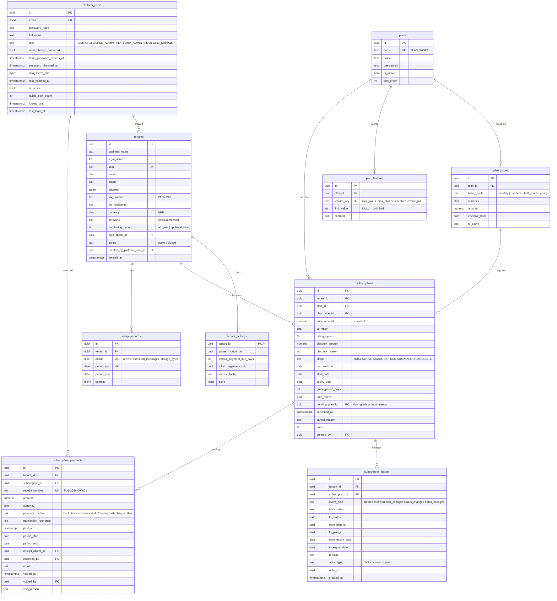

Key constraints and indexes:

| Table | Constraint / index |
|---|---|
| `plan_prices` | `UNIQUE (plan_id, billing_cycle, currency, effective_from)`; `CHECK (amount >= 0)` |
| `plan_features` | `UNIQUE (plan_id, feature_key)` |
| `subscriptions` | **one current subscription per tenant:** `UNIQUE (tenant_id) WHERE status <> 'CANCELLED'`; `CHECK (expiry_date >= start_date)`; `CHECK (grace_period_days BETWEEN 0 AND 60)`; `ix (status, expiry_date)` for the daily job and "expiring soon" |
| `subscription_payments` | `UNIQUE (receipt_number)`; `CHECK (amount > 0)`; `CHECK (period_end > period_start)`; `ix (tenant_id, paid_at DESC)` |
| `usage_records` | `UNIQUE (tenant_id, metric, period_start)` |
| `tenants` | `UNIQUE (slug)`; `ix (status)` |

---

## 5. Identity, access and audit

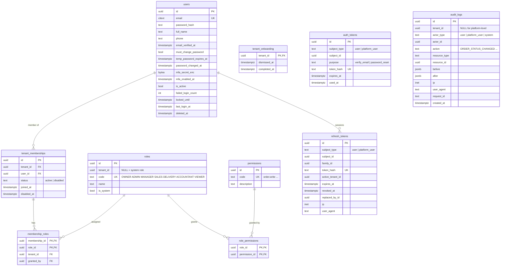

| Table | Constraint / index |
|---|---|
| `users` | `UNIQUE (email) WHERE deleted_at IS NULL` |
| `tenant_memberships` | `UNIQUE (tenant_id, user_id)`; `ix (user_id)` (tenant switcher) |
| `roles` | `UNIQUE (coalesce(tenant_id, '00000000-0000-0000-0000-000000000000'), code)`; system roles seeded |
| `membership_roles` | FK `(tenant_id, membership_id) → tenant_memberships (tenant_id, id)` |
| `refresh_tokens` | `ix (family_id)`; `ix (subject_type, subject_id) WHERE revoked_at IS NULL` |
| `audit_logs` | `ix (tenant_id, created_at DESC)`; `ix (tenant_id, resource_type, resource_id)`; append-only grants |

---

## 6. System tables

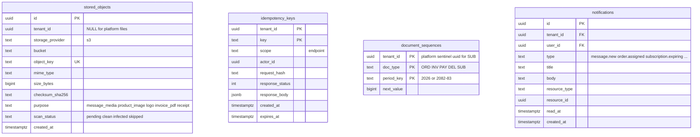

| Table | Constraint / index |
|---|---|
| `stored_objects` | `UNIQUE (bucket, object_key)`; `CHECK (size_bytes >= 0)` |
| `idempotency_keys` | PK `(tenant_id, key)`; `ix (expires_at)` for cleanup |
| `notifications` | `ix (tenant_id, user_id, created_at DESC) WHERE read_at IS NULL` |

---

## 7. Channels and webhooks

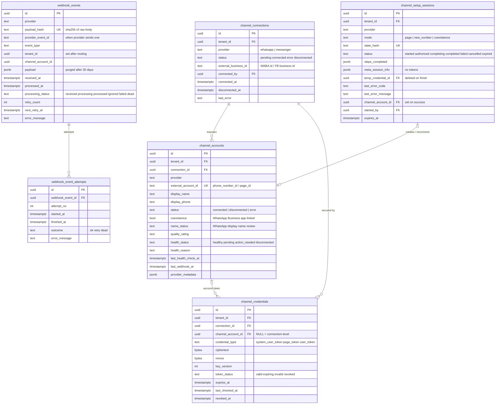

| Table | Constraint / index |
|---|---|
| `channel_accounts` | **a number/page can belong to only one tenant at a time:** `UNIQUE (provider, external_account_id) WHERE status <> 'disconnected'`; `ix (tenant_id, provider)` |
| `channel_setup_sessions` | `UNIQUE (state_hash)`; `ix (tenant_id, created_at DESC)`; expired sessions purged after 30 days (error info kept in audit) |
| `channel_credentials` | `UNIQUE (connection_id, coalesce(channel_account_id, …), credential_type) WHERE revoked_at IS NULL` |
| `webhook_events` | `UNIQUE (provider, payload_hash)`; `UNIQUE (provider, provider_event_id) WHERE provider_event_id IS NOT NULL`; `ix (processing_status, next_retry_at) WHERE processing_status IN ('received','failed')`; `ix (received_at)` for purge |

`webhook_event_attempts` is append-only for `app_runtime` (no `UPDATE`/`DELETE`). `webhook_events` / `webhook_event_attempts` are **not** tenant-scoped (tenant unknown at receipt). Only the ingestion path and `app_platform` access them; tenants see webhook health via `channel_accounts.last_webhook_at`.

---

## 8. Customers

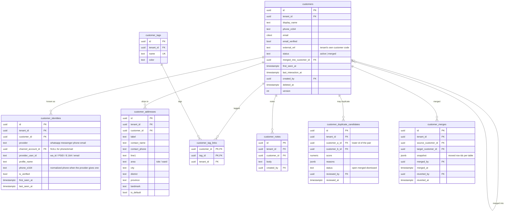

| Table | Constraint / index |
|---|---|
| `customers` | `ix (tenant_id, phone_e164) WHERE status='active' AND deleted_at IS NULL` (not unique: shared family phones exist; resolution logic decides); `ix (tenant_id, email)`; `ix (tenant_id, last_interaction_at DESC)`; GIN trigram on `display_name`; `CHECK (status <> 'merged' OR merged_into_customer_id IS NOT NULL)` |
| `customer_identities` | channel identities: `UNIQUE (tenant_id, channel_account_id, provider_user_id) WHERE channel_account_id IS NOT NULL`; phone/email identities: `UNIQUE (tenant_id, provider, provider_user_id) WHERE channel_account_id IS NULL`; `ix (tenant_id, customer_id)` |
| `customer_addresses` | `UNIQUE (customer_id) WHERE is_default` |
| `customer_tags` | `UNIQUE (tenant_id, lower(name))` |
| `customer_duplicate_candidates` | `UNIQUE (tenant_id, customer_a_id, customer_b_id)`; `CHECK (customer_a_id < customer_b_id)`; `ix (tenant_id, status)` |

Why identities include `channel_account_id`: Messenger PSIDs are unique **per Page**, so the same person messaging two Pages of one tenant has two PSIDs. WhatsApp `wa_id` is stored the same way for uniformity.

---

## 9. Conversations and messages

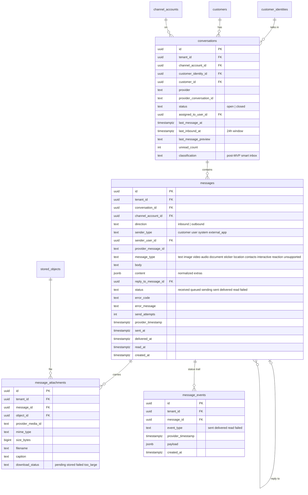

| Table | Constraint / index |
|---|---|
| `conversations` | one thread per identity per account: `UNIQUE (tenant_id, channel_account_id, customer_identity_id)`; inbox: `ix (tenant_id, last_message_at DESC)`, `ix (tenant_id, provider, last_message_at DESC)`, `ix (tenant_id, assigned_to_user_id, last_message_at DESC)`, `ix (tenant_id, last_message_at DESC) WHERE unread_count > 0` |
| `messages` | dedup: `UNIQUE (channel_account_id, provider_message_id) WHERE provider_message_id IS NOT NULL`; thread view: `ix (tenant_id, conversation_id, provider_timestamp DESC)`; resend sweeper: `ix (status, created_at) WHERE status IN ('queued','sending')`; `CHECK (direction='outbound' OR status='received')` |
| `message_events` | `UNIQUE (message_id, event_type)` |

`conversations.customer_id` is denormalized from the identity for fast filtering and is updated by merge/unmerge.

---

## 10. Catalogue and inventory

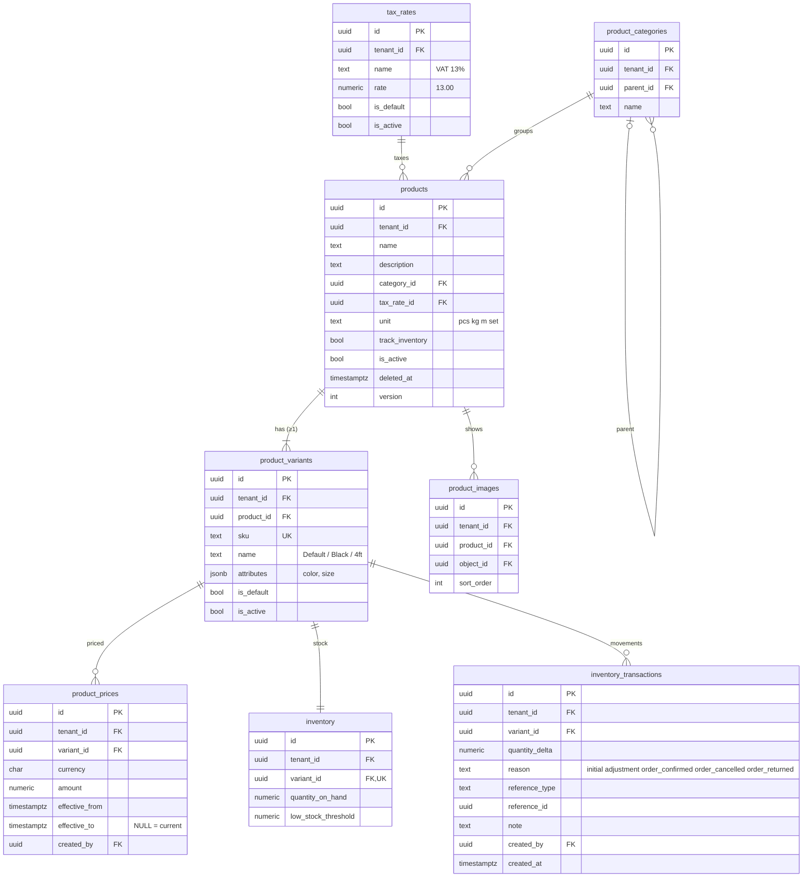

- Every product has **at least one variant** (`is_default`); orders always reference a variant. Products without options just have one default variant — this keeps order/stock logic uniform.
- `inventory.quantity_on_hand` is a cache of `SUM(inventory_transactions.quantity_delta)`, updated in the same transaction (row locked `FOR UPDATE`).

| Table | Constraint / index |
|---|---|
| `product_variants` | `UNIQUE (tenant_id, sku)`; `UNIQUE (product_id) WHERE is_default` |
| `product_prices` | current price: `UNIQUE (variant_id, currency) WHERE effective_to IS NULL`; `CHECK (amount >= 0)` |
| `products` | `ix (tenant_id, is_active)`; GIN trigram on `name` (search / future AI matching) |
| `inventory` | `UNIQUE (variant_id)` |
| `inventory_transactions` | `ix (tenant_id, variant_id, created_at DESC)`; `CHECK (quantity_delta <> 0)` |
| `tax_rates` | `UNIQUE (tenant_id) WHERE is_default`; `CHECK (rate BETWEEN 0 AND 100)` |

---

## 11. Orders and invoices

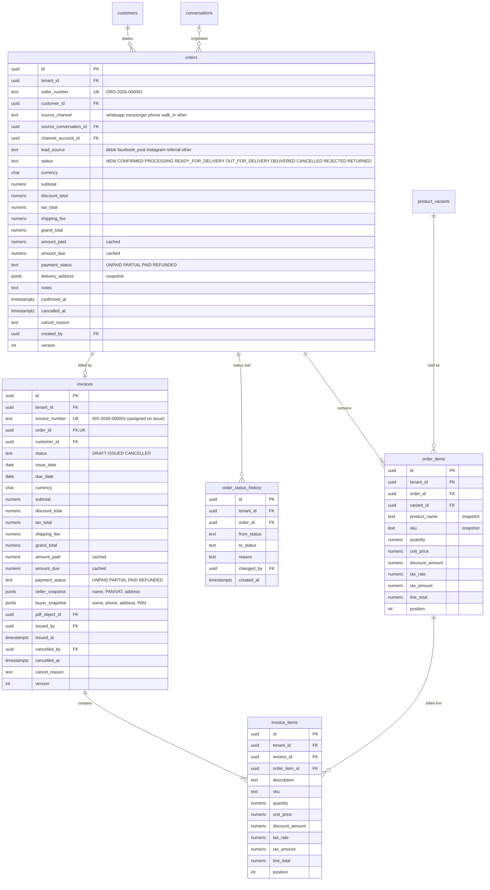

| Table | Constraint / index |
|---|---|
| `orders` | `UNIQUE (tenant_id, order_number)`; `ix (tenant_id, created_at DESC)`; `ix (tenant_id, status)`; `ix (tenant_id, customer_id, created_at DESC)`; `ix (tenant_id, source_channel, created_at)`; `ix (tenant_id, payment_status) WHERE payment_status IN ('UNPAID','PARTIAL')`; `CHECK (grand_total >= 0 AND amount_paid >= 0)` |
| `order_items` | `CHECK (quantity > 0)`; `CHECK (unit_price >= 0)`; `ix (tenant_id, variant_id)` |
| `order_status_history` | `ix (tenant_id, order_id, created_at)` |
| `invoices` | MVP one invoice per order: `UNIQUE (order_id) WHERE status <> 'CANCELLED'`; `UNIQUE (tenant_id, invoice_number)`; `CHECK (status='DRAFT' OR invoice_number IS NOT NULL)`; `ix (tenant_id, status, due_date)` for overdue; trigger blocks updates to totals/items when `status = 'ISSUED'` |

Overdue = `status='ISSUED' AND amount_due > 0 AND due_date < current_date` (tenant timezone), computed at query time.

---

## 12. Deliveries and payments

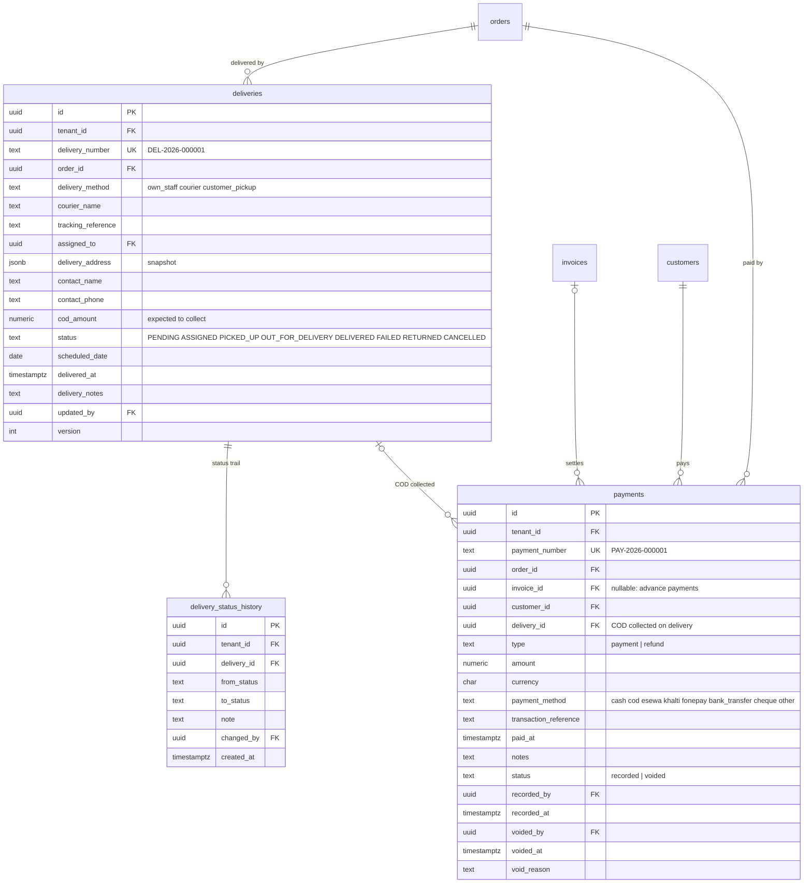

| Table | Constraint / index |
|---|---|
| `deliveries` | one open attempt per order: `UNIQUE (order_id) WHERE status NOT IN ('DELIVERED','FAILED','RETURNED','CANCELLED')`; `UNIQUE (tenant_id, delivery_number)`; `ix (tenant_id, status, scheduled_date)` (today's deliveries card); `ix (tenant_id, assigned_to, status)`; `CHECK (status <> 'DELIVERED' OR delivered_at IS NOT NULL)` |
| `delivery_status_history` | `ix (tenant_id, delivery_id, created_at)` |
| `payments` | `UNIQUE (tenant_id, payment_number)`; `CHECK (amount > 0)`; `CHECK (status <> 'voided' OR (voided_at IS NOT NULL AND void_reason IS NOT NULL))`; `ix (tenant_id, order_id)`; `ix (tenant_id, paid_at DESC)`; `ix (tenant_id, payment_method, paid_at)`; only void columns are updatable |

Balance rule (in the same transaction as every payment insert/void, with the order row locked):

```text
amount_paid = Σ amount (type=payment, status=recorded) − Σ amount (type=refund, status=recorded)
amount_due  = grand_total − amount_paid
payment_status = PAID      if amount_due <= 0 and amount_paid > 0
               = REFUNDED  if any refund and amount_paid <= 0
               = PARTIAL   if 0 < amount_paid < grand_total
               = UNPAID    otherwise
```

---

## 13. Complete relationship map

Simplified (keys only) view across all domains:

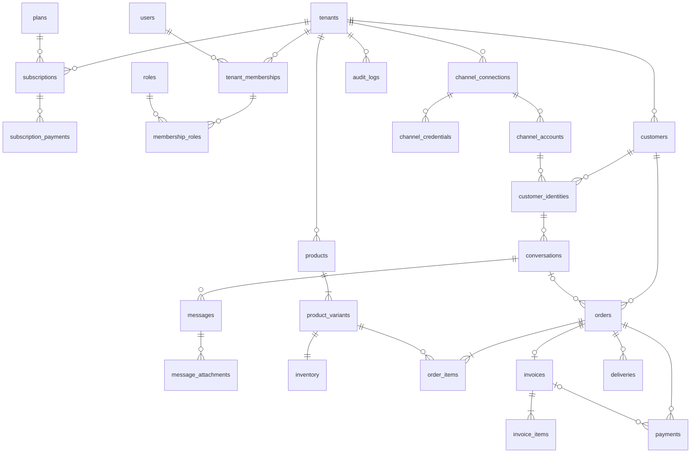

---

## 14. Key queries and their indexes

| Screen / job | Query shape | Index |
|---|---|---|
| Inbox list | conversations by tenant (+ provider / assignee / unread), newest first | `conversations (tenant_id, …, last_message_at DESC)` |
| Conversation view | messages by conversation, newest first, cursor | `messages (tenant_id, conversation_id, provider_timestamp DESC)` |
| Webhook dedup | message by provider id | `messages (channel_account_id, provider_message_id)` |
| Webhook routing | account by external id | `channel_accounts (provider, external_account_id)` |
| Identity lookup | identity by account + provider user id | `customer_identities` partial uniques |
| Customer search | phone / email / name | `customers (tenant_id, phone_e164)`, `(tenant_id, email)`, trigram on name |
| Customer 360 | orders / payments / deliveries by customer | `orders (tenant_id, customer_id, created_at DESC)` etc. |
| Dashboard sales | Σ grand_total by day/channel | `orders (tenant_id, created_at)`, `(tenant_id, source_channel, created_at)` |
| Pending payments | unpaid/partial orders | partial index on `orders.payment_status` |
| Overdue | issued invoices past due with balance | `invoices (tenant_id, status, due_date)` |
| Today's deliveries | deliveries by status and date | `deliveries (tenant_id, status, scheduled_date)` |
| Subscription job | subscriptions by status and expiry | `subscriptions (status, expiry_date)` |
| Retry sweepers | stuck events / queued messages | partial indexes on status |

All verified with `EXPLAIN ANALYZE` on seeded data (≥ 1,000 tenants, 5M messages) during performance testing.

---

## 15. Seed data

Applied by a dedicated seed command (idempotent), not by migrations:

- `permissions` — the full permission list (ARCHITECTURE.md §7)
- `roles` — 7 system roles and their `role_permissions`
- `plans`, `plan_prices`, `plan_features` — initial packages (values to be decided; placeholders in dev)
- first `platform_users` super admin from env (`BOOTSTRAP_ADMIN_EMAIL`, temporary password printed once by the seed command, change forced at first login)
- dev only: two demo tenants with products and customers for local testing and cross-tenant tests

---

## 16. Retention

| Data | Retention |
|---|---|
| `webhook_events.payload` | 30 days, then set to `NULL` (row kept 1 year) |
| `idempotency_keys` | 24 hours |
| `refresh_tokens`, `auth_tokens`, invitations | deleted 30 days after expiry/revocation |
| `audit_logs` | ≥ 3 years (configurable); later moved to monthly partitions / cold storage |
| messages, orders, invoices, payments | tenant lifetime; deleted/anonymized by tenant deletion workflow (spec §28) |
| Cancelled tenant data | retained N days (config, default 90) after cancellation, then deletion workflow |
